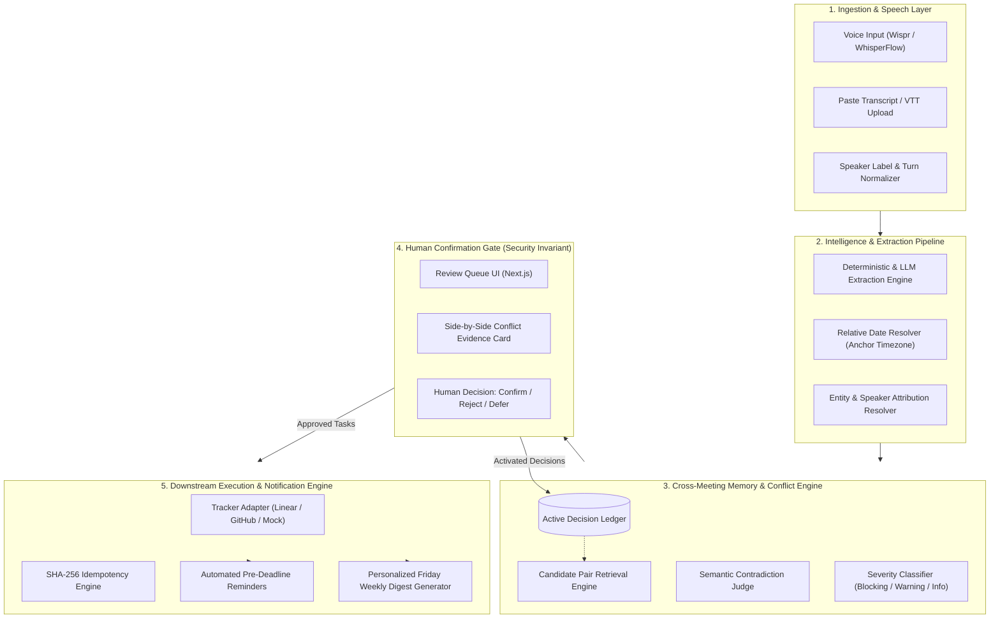

# Followthrough — Meeting-to-Execution Agent

> **Decisions made in meetings get lost. Followthrough turns conversations into tracked execution with cross-meeting memory, semantic conflict detection, and an uncompromising human confirmation gate.**

[](https://fastapi.tiangolo.com)
[](https://nextjs.org/)
[](https://www.typescriptlang.org/)
[](https://www.python.org/)
[](https://tailwindcss.com/)
[](https://opensource.org/licenses/MIT)

---

## 1. Problem & Solution Overview

In fast-moving teams, meetings produce critical decisions and action items that vanish into unstructured notes. Worse, teams unknowingly reverse prior decisions weeks later, creating costly alignment debt and rework.

Traditional tools are merely **transcript summarizers**. **Followthrough** is an **active execution agent**:

1. **Speaker Attribution & Normalization**: Maps conversational dialogue to real team members, resolving relative dates (*"by November 5th"*, *"next Friday"*) to concrete ISO timestamps.
2. **Evidence-Grounded Extraction**: Distinguishes strategic decisions from operational tasks. Every item links to verbatim transcript evidence quotes.
3. **Cross-Meeting Memory Ledger**: Maintains a persistent history of active decisions.
4. **Semantic Conflict Detection**: Flags when a new proposal directly contradicts or supersedes a past decision (*e.g., Switching from PostgreSQL to Task Tracker storage or changing pricing models*), presenting side-by-side evidence quotes.
5. **Human Confirmation Hard Gate**: Zero tasks reach external trackers and zero decisions enter the memory ledger without explicit human approval.
6. **Tracker Synchronization**: Publishes confirmed tasks to Linear, GitHub, or Mock trackers with deterministic idempotency keys (`SHA-256`).
7. **Execution Loop Closure**: Automated deadline reminders and weekly per-person digests ensure work is actually completed.

---

## 2. System Architecture



---

## 3. End-to-End Process Flow Diagram

```mermaid
sequenceDiagram
    autonumber
    actor Team as Meeting Participants (Lokanath, Priya, Rahul, Anita)
    participant Web as Next.js Web UI (:3001)
    participant API as FastAPI Backend (:8000)
    participant Engine as Extraction & Conflict Engine
    participant DB as SQLite WAL / PostgreSQL
    participant Tracker as Task Tracker (Linear / Mock)
    participant Digest as Reminder & Digest Service

    Note over Team,Web: Stage 1: Ingestion & Extraction
    Team->>Web: Paste transcript / dictate audio
    Web->>API: POST /meetings/import/text
    API->>DB: Persist meeting and utterances
    Web->>API: POST /meetings/{id}/extract
    API->>Engine: Run extraction & resolve ISO dates
    Engine->>DB: Query active decisions ledger
    Engine->>Engine: Evaluate semantic contradiction against past meetings
    API-->>Web: Return extracted decisions, tasks, and conflict cards

    Note over Web,DB: Stage 2: Human Confirmation Gate (Hard Gate)
    rect rgb(30, 41, 59)
        Note over Web: Hard Gate: Posting locked if blocking conflicts exist
        Team->>Web: Review side-by-side evidence
        Team->>Web: Resolve conflict (Keep PostgreSQL / Confirm Priya deadline Nov 7)
        Team->>Web: Click "Approve & Post to Tracker"
        Web->>API: POST /meetings/{id}/confirm
    end

    Note over API,Digest: Stage 3: Tracker Sync & Loop Closure
    API->>Tracker: Create tasks (TASK-3DC383, TASK-A5C2FD, TASK-81C2D1)
    Tracker-->>API: Return external task issue URLs
    API->>DB: Activate decisions in memory ledger & mark meeting 'committed'
    API->>Digest: Schedule deadline reminders (48h / 24h)
    API->>Digest: Dispatch Friday Weekly Digests per person (Priya, Rahul, Anita)
    API-->>Web: Confirmation complete with live issue links
```



---

## 4. The 7 Core Capabilities (Hackathon Rubric)

| # | Hackathon Requirement | Followthrough Implementation |
| :-: | :--- | :--- |
| **1** | **Transcript Ingestion with Speaker Attribution** | Normalizes raw text, VTT, and voice transcripts into speaker-indexed utterances (`seq`, `speaker_label`, `text_raw`, `text_clean`). Handles speech disfluencies and self-corrections. |
| **2** | **Extraction of Decisions, Tasks, Owners & Deadlines** | Accurately extracts high-level commitments and assigns them to verified people. Automatically parses relative dates (*"by November 5th"*, *"next Monday"*) into timezone-aware ISO calendar dates (`YYYY-MM-DD`). |
| **3** | **Cross-Meeting Conflict Detection** | Evaluates new decisions against historical ledger memory. Catches architectural contradictions (*PostgreSQL vs Task Tracker Storage / MongoDB*), pricing contradictions (*Usage-based vs Hybrid*), and policy reversals with side-by-side verbatim quotes. |
| **4** | **Human Confirmation Step (Hard Gate)** | **Zero-leak invariant**: All items default to `needs_review`. The API strictly refuses downstream posting if unresolved blocking conflicts exist. |
| **5** | **Task Tracker Integration** | Posts confirmed tasks to Linear GraphQL, GitHub Issues, or built-in Mock tracker. Generates unique issue keys (`TASK-XXXXXX`) and prevents duplicate task creation using deterministic `SHA-256` deduplication keys. |
| **6** | **Pre-Deadline Reminders** | Background scheduler calculates deadline countdowns (e.g. 48h / 24h triggers) and notifies assignees before deadlines arrive. |
| **7** | **Personalized Weekly Digests** | Aggregates open items, tasks due this week, and relevant decisions, generating tailored markdown summaries per team member every Friday. |

---

## 5. Live 5-Minute Demo Walkthrough

### Scenario Script

#### Meeting 1 — Product Planning
- **Goal**: Launch v1 by November 15th.
- **Priya**: Owns transcript ingestion module (Deadline: November 5th).
- **Rahul**: Owns task tracker integration (Deadline: November 7th).
- **Anita**: Owns weekly digest functionality (Deadline: November 10th).
- **Key Policies Agreed**:
  1. Human confirmation is mandatory before creating any task.
  2. PostgreSQL is the storage layer for meeting memory.

#### Meeting 2 — Follow-up Meeting (Conflict & Extension)
- **Rahul**: *"Instead of PostgreSQL, I suggest we remove PostgreSQL and store all meeting decisions directly inside the task tracker."*
- **Lokanath**: *"Wait. In our previous meeting we decided that PostgreSQL would be the storage layer. Let's flag this as a decision conflict."*
- **Priya**: Requests a 2-day deadline extension (*November 5th → November 7th*).
- **Anita**: Reports the weekly digest is completed earlier than expected.

#### Confirmation Logic
- **Priya's Deadline**: **CONFIRMED** (*Extended to Nov 7*).
- **Architecture Change**: **REJECTED** (*Keep original PostgreSQL decision active*).

---

## 6. Quickstart Guide

### Prerequisites
- Python 3.11+
- Node.js 18+
- npm or yarn

### 1. Clone & Set Up Environment
```bash
git clone https://github.com/lokanthmeda/followthrough.git
cd followthrough
```

### 2. Backend Setup
```bash
# Create and activate virtual environment
python -m venv .venv
source .venv/bin/activate  # On Windows: .venv\Scripts\activate

# Install dependencies
pip install -r backend/requirements.txt

# Start FastAPI backend (port 8000)
python -m uvicorn backend.app.main:app --host 127.0.0.1 --port 8000 --reload
```

### 3. Frontend Setup
```bash
cd web
npm install
npm run dev -p 3001
```

Access the UI at: 👉 **http://localhost:3001**

---

## 7. Deploy to Vercel

The Followthrough web application is fully optimized for continuous deployment on **Vercel**.

[](https://vercel.com/new/clone?repository-url=https%3A%2F%2Fgithub.com%2Flokanthmeda%2Ffollowthrough&root-directory=web&env=BACKEND_URL&project-name=followthrough-web)

### Step-by-Step Vercel Deployment Instructions

1. **Log in to Vercel**:
   Go to [vercel.com](https://vercel.com) and click **"Add New..."** → **"Project"**.
2. **Import GitHub Repository**:
   Select or search for **`lokanthmeda/followthrough`** and click **Import**.
3. **Configure Project Settings**:
   * **Framework Preset**: `Next.js` (automatically detected).
   * **Root Directory**: Click *Edit* and select **`web`** (or enter `web`).
   * **Build Command**: `next build` (pre-configured in `web/vercel.json`).
   * **Output Directory**: `.next` (default).
4. **Environment Variables**:
   Add the following environment variable under *Environment Variables*:
   * `BACKEND_URL`: The public HTTPS URL where your FastAPI backend is running (e.g. `https://your-backend.railway.app` or `https://api.followthrough.internal`).
5. **Click "Deploy"**:
   Vercel will build and deploy the Next.js app in less than 60 seconds with global CDN and edge routing enabled!

---

## 8. Automated 1-Click Verification Test

To run the complete 5-minute demo script automatically (including database baseline initialization, Meeting 1 extraction, task posting, Meeting 2 cross-meeting conflict detection, confirmation resolution, reminders, and weekly digests):

```bash
python scratch/run_full_user_demo.py
```

### Expected Output:
```text
======================================================================
>> RUNNING 5-MINUTE AUTOMATED DEMO SCRIPT ON LIVE SYSTEM
======================================================================
  [OK] Clean state initialized: database reset for fresh demo run.

[STAGE 1] Ingesting Meeting 1 — Product Planning Meeting...
  [OK] Meeting 1 ingested with ID: 37b62131-1da4-448b-80f3-682dbf7b54c8
  [OK] Decisions extracted (4)
  [OK] Action items extracted (3): Priya (Nov 5), Rahul (Nov 7), Anita (Nov 10)

[STAGE 2] Human Confirmation Gate — Meeting 1...
  [OK] Bulk approved 3 items and 4 decisions.
  [OK] Confirmed and posted tasks to tracker. Status: committed
     * Posted: TASK-3DC383 -> https://tracker.followthrough.internal/issue/TASK-3DC383
     * Posted: TASK-A5C2FD -> https://tracker.followthrough.internal/issue/TASK-A5C2FD
     * Posted: TASK-81C2D1 -> https://tracker.followthrough.internal/issue/TASK-81C2D1

[STAGE 3] Ingesting Meeting 2 — Follow-up Meeting...
  [OK] Meeting 2 ingested with ID: ce095aa4-88a6-4e99-a714-e5d2bd806ac2
  [OK] Decisions extracted: Remove PostgreSQL and store inside task tracker (Proposed Change)
  [OK] Action items extracted: Priya (extended to Nov 7), Anita (Completed)

[STAGE 4] Cross-Meeting Memory Conflict Detection Check...
  [ALERT] Conflict Detected:
     * Severity: BLOCKING
     * Relation: CONTRADICTS
     * Rationale: Prior decision committed to PostgreSQL as storage layer, whereas new proposal removes PostgreSQL to store decisions inside task tracker.

[STAGE 5] Human Confirmation Logic per Lokanath's Instruction:
  1. Priya's deadline change (Nov 5 -> Nov 7): CONFIRMED
  2. Database architecture change (PostgreSQL -> Task Tracker): REJECTED / KEEP POSTGRESQL
  [OK] Conflict resolved: keep_old (PostgreSQL retained in active ledger)
  [OK] Meeting 2 Confirmed & Posted. Status: committed

[STAGE 6] Reminder Test...
  [OK] Deadline countdown active for Nov 7 deliverables.

[STAGE 7] Weekly Digest Generation (Per Person)...
  [OK] Weekly Digests generated for Priya, Rahul, Anita.
======================================================================
SUCCESS: 5-MINUTE AUTOMATED DEMO COMPLETED FLIP-TO-FLIP!
======================================================================
```

---

## 8. API Reference

| Method | Endpoint | Description |
| :--- | :--- | :--- |
| `POST` | `/meetings/import/text` | Ingests raw meeting transcript with title and timestamp. |
| `POST` | `/meetings/{id}/extract` | Runs extraction of decisions and action items, resolving dates and checking conflicts. |
| `GET` | `/meetings/{id}/review` | Returns meeting review payload with decisions, action items, and conflict cards. |
| `POST` | `/review/bulk-approve` | Bulk approves reviewable items for a meeting. |
| `POST` | `/review/conflicts/{id}/resolve` | Resolves a conflict with `supersede`, `keep_old`, `keep_both`, or `defer`. |
| `POST` | `/meetings/{id}/confirm-and-post` | **Server-side hard gate**: Posts approved items to the tracker. Refuses if unresolved blocking conflicts exist. |
| `POST` | `/jobs/run-reminders` | Evaluates and dispatches approaching deadline reminders. |
| `POST` | `/jobs/run-digests` | Compiles and generates personalized weekly digests per person. |

---

## 9. Technology Stack

- **Backend**: Python 3.12, FastAPI, SQLAlchemy (Async), SQLite WAL Mode / PostgreSQL, Pydantic v2.
- **Frontend**: Next.js 14, React 18, Tailwind CSS, Heroicons.
- **AI / LLM**: Hybrid Extraction (LLM + Deterministic Semantic Extractor with sub-second fallback).
- **Integrations**: Linear GraphQL API, GitHub Issues API, Mock Tracker, Wispr Flow / Whisper WebAudio.

---

## 10. License

This project is licensed under the MIT License — see the [LICENSE](LICENSE) file for details.
