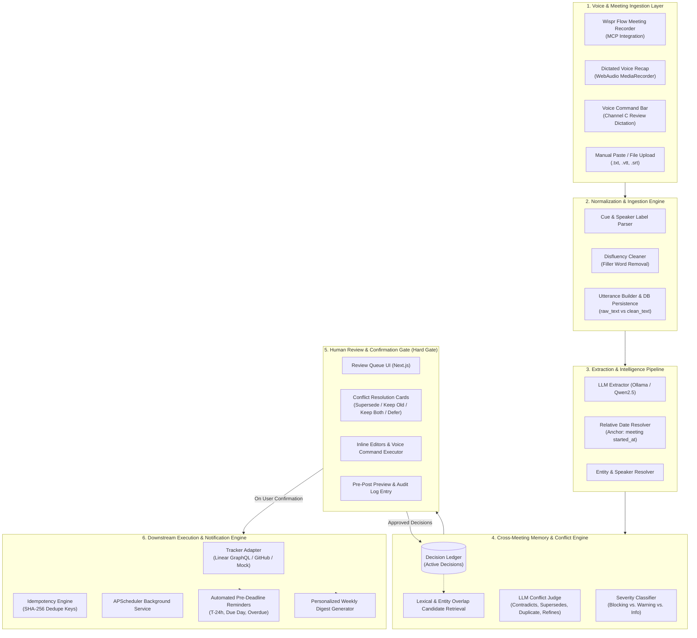
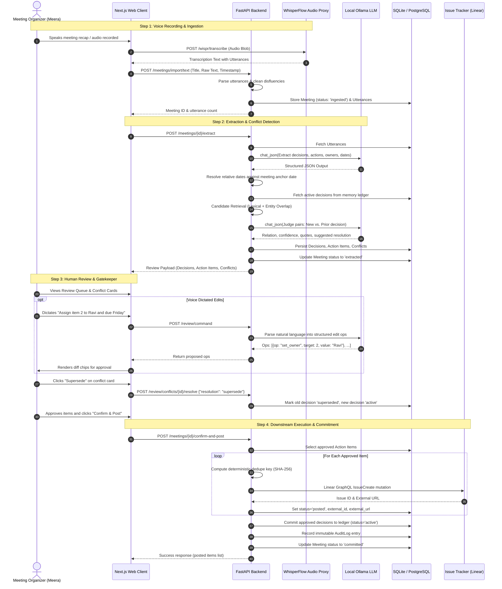
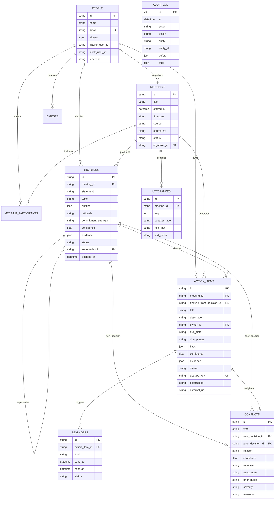

# Followthrough — Complete System Documentation & Workflow Specification

## 1. Executive Summary

**Followthrough** is an Agentic AI Meeting-to-Execution platform engineered for the Product Space Agentic AI Hackathon. Unlike traditional meeting summarizers that generate static notes and forget historical context, Followthrough acts as an active **commitment ledger** and **execution engine**.

### The Core Problem It Solves
1. **Meeting amnesia & lost tasks**: Action items get lost in unstructured notes, and implicit verbal commitments are forgotten.
2. **Silent contradictory decisions**: Organizations reverse previous decisions in subsequent meetings without realizing it, leading to wasted engineering sprints and misaligned teams.
3. **Premature / uncontrolled autonomous actions**: AI tools that write directly to Jira/Linear without human review cause hallucinations and task spam.

### How Followthrough Solves It
- **Voice-Native Input (Wispr Flow)**: Ingests audio and dictated recaps, handling disfluencies ("um", "uh") and speech self-corrections ("Friday — no, wait, Monday").
- **Evidence-Grounded Extraction**: Extracts decisions, action items, owners, and resolved deadlines. Every item *must* cite a verbatim quote from a transcript utterance.
- **Cross-Meeting Decision Memory & Conflict Detection**: Evaluates every newly extracted decision against prior active decisions in memory, classifying relations (`contradicts`, `supersedes`, `duplicate`, `refines`, `unrelated`) with side-by-side evidence quotes.
- **Strict Human-in-the-Loop Confirmation Gate**: An uncompromising security invariant where **zero items** reach the project tracker or decision ledger without human approval.
- **Execution Loop Closure**: Synchronizes approved tasks to Linear/GitHub, triggers automated pre-deadline reminders, and generates personalized weekly digests.

---

## 2. System Architecture



---

## 3. End-to-End Pipeline Workflow



---

## 4. Key Subsystems & How They Work

### 4.1 Ingestion & Disfluency Normalization
- **Channels**:
  - `Channel A`: Wispr Flow Meeting Recorder via MCP.
  - `Channel B`: Dictated voice recap via Web Audio API `MediaRecorder` sent to `/wispr/transcribe`.
  - `Channel C`: Review queue voice command dictation.
  - `Channel D`: Direct text paste / subtitle cues (`.vtt`, `.srt`).
- **Processing**:
  - `normalize_transcript`: Splits raw speech by speaker tags (e.g., `Arjun: ...`, `Meera: ...`) or parses timestamp cues.
  - `clean_disfluencies`: Strips conversational fillers (`um`, `uh`, `like`, `you know`) to create `text_clean`, while preserving `text_raw` verbatim for auditing and evidence quotes.

### 4.2 LLM Extraction Engine
- **Prompt Architecture**: Strict JSON schema enforcement with schema definition, context parameters (meeting date/time anchor, timezone `Asia/Kolkata`, known attendees).
- **Core Rules**:
  1. **Evidence Mandatory**: Every decision and action item must supply verbatim quote(s) and sequence ID. Without quotes, items are dropped.
  2. **No Hallucinations**: Missing owners or deadlines are set to `null` and flagged (`needs_owner`, `needs_deadline`).
  3. **Self-Correction Logic**: When a speaker self-corrects ("Friday — no, Monday"), the last value is taken and a `correction_note` is attached.
  4. **Relative Date Resolution**: Expressions like `next Monday`, `this Friday`, `by EOD tomorrow` are mathematically mapped to exact ISO `YYYY-MM-DD` strings using the meeting's start time anchor.
  5. **Auto-Repair Retry**: If the local LLM emits malformed JSON, the pipeline catches the error and invokes an immediate repair prompt before failing safely.

### 4.3 Cross-Meeting Decision Memory & Conflict Engine
- **Memory Ledger**: Approved decisions persist with topics, extracted entities, and status (`active`, `superseded`, `reversed`, `withdrawn`).
- **Detection Workflow**:
  ```mermaid
  flowchart LR
      N[New Extracted Decision] --> CR[Candidate Retrieval<br/>Token & Entity Overlap]
      P[Active Prior Decisions] --> CR
      CR -->|Candidate Pairs| J[LLM Conflict Judge]
      J --> V{Relation & Confidence}
      V -->|Contradicts / Supersedes / Duplicate >= 0.75| B[Blocking Conflict]
      V -->|Confidence 0.5 - 0.75| W[Possible Conflict / Warning]
      V -->|Refines| I[Info Link]
      V -->|Unrelated| D[Discarded]
  ```
- **Conflict Taxonomy**:
  - **C1 Direct Contradiction**: Mutually exclusive statements (e.g., "No Android in v1" vs. "Android will launch in v1").
  - **C2 Silent Parameter Supersession**: A parameter (pricing, date, vendor) is altered without explicitly acknowledging previous decisions.
  - **C3 Re-litigation / Duplicate**: The exact same decision restated or reopened.
- **Resolution Operations**:
  - **Supersede**: New decision becomes `active`, old decision becomes `superseded` with `supersedes_id` lineage.
  - **Keep Old**: New decision is rejected; related actions flagged.
  - **Keep Both**: Marked as co-existing without conflict.
  - **Defer**: Retained as open for future meeting discussion.

### 4.4 The Human Confirmation Gate
- **Invariant**: No external state mutations (tracker issue creation, assignment emails, memory updates) occur prior to explicit human approval.
- **Enforcement**:
  - Unresolved blocking conflicts prevent action items from being approved (HTTP 422 gate).
  - Only items explicitly flagged `status == 'approved'` are processed during `/confirm-and-post`.
  - Idempotency via SHA-256 deduplication:
    $$\text{dedupe\_key} = \text{SHA256}(\text{meeting\_id} \parallel \text{normalized\_title} \parallel \text{owner})[:32]$$
  - Full audit logging in the `audit_log` table storing `actor`, `action`, `before`, and `after` snapshots.

### 4.5 Task Tracker Adapter Layer
- Follows the adapter pattern (`TrackerAdapter` protocol):
  - `LinearAdapter`: Communicates over Linear GraphQL API (`issueCreate`, `find_user_by_email`).
  - `GitHubAdapter`: Creates GitHub Issues via REST API.
  - `MockAdapter`: Safe demo mode requiring zero third-party credentials.

### 4.6 Reminders & Weekly Digest Subsystem
- **APScheduler**:
  - Runs every 15 minutes to evaluate upcoming deadlines.
  - Fires notifications at **T-24h**, **Day-of at 09:00 IST**, and **Overdue +1d**.
  - Weekly Monday 09:00 IST cron compiles per-person digests:
    - Tasks due this week.
    - Overdue items.
    - Active decisions that affect the person.
    - Unresolved conflicts requiring their input.

---

## 5. Database Schema (Entity Relationship Diagram)



---

## 6. API Reference

| Endpoint | Method | Description |
|---|---|---|
| `/wispr/transcribe` | `POST` | Accepts multi-part audio, calls local speech proxy, returns transcribed segments |
| `/meetings` | `GET` | Lists all meetings with status and metadata |
| `/meetings/import/text` | `POST` | Ingests raw meeting text and generates normalized utterance rows |
| `/meetings/{id}/extract` | `POST` | Runs the full LLM extraction and memory conflict detection pipeline |
| `/meetings/{id}/review` | `GET` | Fetches review queue data (decisions, action items, conflicts, quotes) |
| `/review/items/{item_id}` | `PATCH` | Edits action item details or sets status to `approve` / `reject` |
| `/review/conflicts/{id}/resolve` | `POST` | Resolves a conflict (`supersede`, `keep_old`, `keep_both`, `defer`) |
| `/review/command` | `POST` | Dictated natural language voice command parser (Channel C) |
| `/meetings/{id}/post-preview` | `POST` | Returns exact list of approved items that will be submitted to tracker |
| `/meetings/{id}/confirm-and-post` | `POST` | **Hard Gate**: Server-side idempotency post to Linear and commits memory |

---

## 7. How to Run Locally

### 1. Prerequisites
- Python 3.10+
- Node.js 18+
- [Ollama](https://ollama.com) installed and serving model `qwen2.5:0.5b` (`ollama run qwen2.5:0.5b`)

### 2. Backend Setup
```bash
cd backend
python -m venv venv
.\venv\Scripts\activate   # On Windows
pip install -r requirements.txt
uvicorn app.main:app --port 8000 --reload
```

### 3. Frontend Setup
```bash
cd web
npm install
npm run dev
```
Access the application at `http://localhost:3000`.

